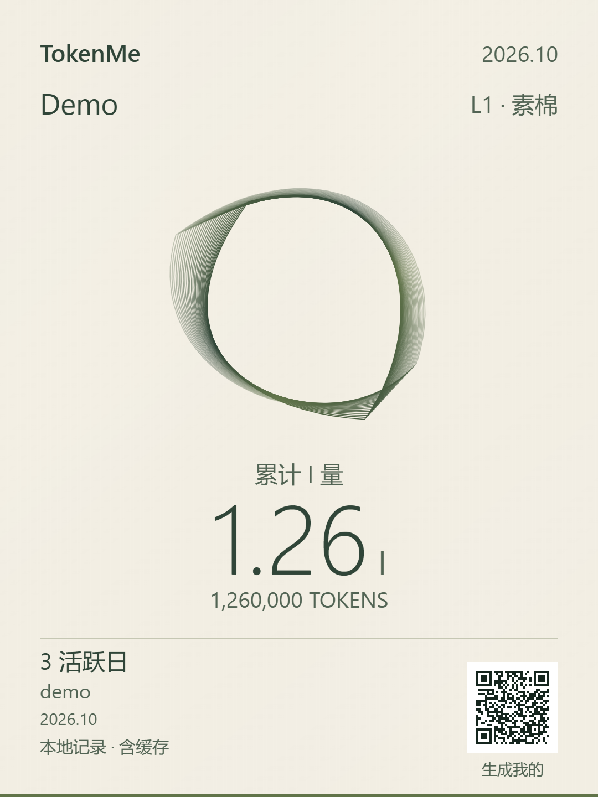

# TokenMe · 我的 AI 足迹

把真实的 AI 使用记录，变成值得收藏与分享的一张图。

**v0.1.0 · 本地保存 · 离线报告 · 零第三方运行依赖**

支持 Codex、WorkBuddy 本地记录和 ccusage 导出桥接。累计 I 量、五种材质、个人使用节奏纹样、两种画幅与可关闭的传播二维码已经可用。低用量也有完整的设计。



上图为合成演示数据，不包含真实用户记录。

## 开始使用

需要 **Python 3.10+** 和现代浏览器。下载 [v0.1.0 源码](https://github.com/lmf112358/TokenMe/archive/refs/tags/v0.1.0.zip)，解压后在项目目录执行：

```shell
python -m token_footprint scan --open
```

也可以克隆仓库：

```shell
git clone https://github.com/lmf112358/TokenMe.git
cd TokenMe
python -m token_footprint scan --open
```

浏览器打开 `.local/report/report.html`。选择昵称、竖版或方版，保存 PNG；也可右键或长按预览保存。不要求 Node.js，不要求登录 TokenMe。

可选安装：`python -m pip install .`，之后使用 `tokenme scan --open`；旧命令 `token-footprint` 仍可用。Windows 若 `python` 不可用，可尝试 `py -3`。本版采用 Python 命令行启动，尚无独立桌面安装器。

## v0.1 完整流程

- **采集**：Codex 累计差分、fork 重放去重，WorkBuddy 按 trace 更新。
- **保存**：SQLite 持久历史；重复扫描不会重复累计，原日志删除后保留已经入库的记录。
- **分析**：按月或全部历史查看输入、输出、缓存、活跃日、工具分布与采集诊断。
- **分享**：1080 × 1440 竖图 / 1080 × 1080 方图；原生 Canvas，预览与导出像素一致。
- **传播**：可关闭的「生成我的」二维码，仅指向本仓库，不携带个人数据。
- **迁移**：白名单 JSONL 导出、恢复、仅用历史库重建报告。

### I 量与材质

**1 I = 1,000,000 原生 Token**，仅为用量缩写。分享图使用累计历史，与报告月份独立；等级不按月清零，纠错后重算。

| 等级 | 累计 Token | 材质 |
|---|---|---|
| L1 | 大于 0、小于 1000万 | 素棉 |
| L2 | 1000万至小于 1亿 | 染纸 |
| L3 | 1亿至小于 10亿 | 珠光 |
| L4 | 10亿至小于 100亿 | 钛银 |
| L5 | 100亿及以上 | 墨金 |

没有有效记录时暂不评级。材质不是能力、产出或费用评分；没有真实比较样本时不展示虚构百分位。[设计与历史原型](docs/share-card-design.md) 保留供迭代。

### 来源与月份

```shell
python -m token_footprint scan --month 2026-10
python -m token_footprint scan --sources workbuddy --workbuddy-root "D:/MyWorkBuddy"
python -m token_footprint scan --codex-root "D:/MyCodex" --offset +08:00
```

默认读取用户目录的 `.codex/sessions`、`.codex/archived_sessions`、`.workbuddy/traces`。Codex 默认路径尊重已有 `CODEX_HOME`。`--home` 可指定备份用户目录；程序不修改源日志。

`--sources` 只选择本次扫描的来源。**报告包含该历史库全部已保存来源**；`--sources none` 可用于仅导入备份。`--no-history` 只统计本次输入，不读取或保存历史。

### 历史与备份

默认历史库为输出目录内的 `history.sqlite3`。持续使用相同输出目录；换输出目录时用 `--store` 指向原库。一个库对应一个人的一组数据来源，不要混入他人或无法排除重叠的账号/设备。

```shell
# 不扫描客户端，仅重建报告
python -m token_footprint report --open

# 导出可迁移记录
python -m token_footprint export --out .local/backup/records.jsonl

# 新目录恢复；重复恢复不会重复累加
python -m token_footprint scan --sources none --import-records .local/backup/records.jsonl --out .local/restored

# 原库生成另一个月份的报告
python -m token_footprint report --store .local/report/history.sqlite3 --out .local/october --month 2026-10
```

每次报告也附带 `records.jsonl`，可作为可移植快照。历史库保存成功但 HTML 写入失败时，可用 `report` 重建。建议定期把导出复制到自己的备份位置；本地库不具备云同步或磁盘故障恢复能力。

WorkBuddy 较新 trace 替代旧快照。ccusage 同工具同日的**最后一次导入为权威修订值**，可上调或下调，不要用过时或不完整的日桶覆盖新数据。请求增量冲突会拒绝整批入库，需检查日志。详见 [历史库说明](docs/history.md)。

## 可选接入

### Codex 官方账号活动

通过已登录的原生 Codex 客户端联网读取 `account/usage/read`，不发起模型任务，不读取认证文件。客户端或账号不支持接口时会明确报错。

```shell
python -m token_footprint account --codex-bin "完整路径/codex.exe" --out .local/account-usage.json
python -m token_footprint report --account-file .local/account-usage.json --open
```

macOS/Linux 传入原生 `codex` 完整路径；不接受 `.ps1`、`.cmd`、`.bat`、`.sh` 包装器。账号摘要只在提供 `--account-file` 的报告中展示，**不计入本地历史、I 量或等级**，不声称覆盖普通 ChatGPT 聊天的全部活动。

### ccusage 已有导出

在已安装并审查过的 ccusage 中运行 `ccusage daily --by-agent --json --no-cost`，保存 UTF-8 JSON 后导入：

```shell
python -m token_footprint scan --sources none --ccusage my-ccusage.json --out .local/ccusage --offset +08:00
```

桥接接受 unified per-agent 日桶，验证 `totalTokens = inputTokens + cacheReadTokens + cacheCreationTokens + outputTokens`，不自动安装或执行 ccusage。`--offset` 必须与原导出日界线一致；含日桶的库不能切换偏移。同一工具的原生日志与 ccusage 不能混入同一库，避免跨次重复计数。

## 数据边界与隐私

总量 = 输入（含缓存）+ 输出（含推理）。缓存与推理是子集，未知字段保留 null。不同分词器的 Token 相加只表示原生数量，不代表等价算力。积分、订阅额度和金额不换算成 Token。

| 入口 | v0.1 状态 |
|---|---|
| Codex 本地桌面 / CLI、WorkBuddy 桌面 | Windows 真实日志实测 |
| Codex 官方账号摘要 | 可选独立视图，接口曾在本机实测 |
| Kimi Code / Qwen Code 等 | ccusage JSON 桥接，合成数据验证 |
| Kimi / 千问 / DeepSeek 普通网页与 App | 未接入；不以开发者 API 账单替代 |
| 跨设备全量同步、排行榜、服务商认证 | 不在 v0.1 范围 |

扫描和报告离线运行；显式 `account` 查询、安装依赖或点击公开链接才会联网。白名单导出不含提示词、对话正文、会话标题、源文件路径、账号凭据。报告仍包含个人用量和模型信息，请自行保管；PNG 仅包含画面可见字段。

历史不会补回首次扫描前已经删除的日志。固定 UTC 偏移尚不处理夏令时。WorkBuddy 跨日 trace 归入结束日；异常中断及子代理覆盖仍需核对。详见 [统计设计](docs/design.md) 和 [验证范围](docs/validation.md)。

## 开发、贡献与发布

```shell
python -m unittest discover -s tests -v
node --test tests/test_share_card.cjs
python -m pip install build==1.2.2.post1
python -m build
python scripts/verify_wheel.py
```

Node.js 18+ 仅用于开发测试。GitHub Actions 在 Windows、macOS、Linux 运行合成测试；版本 tag 通过检查后生成 GitHub Release 与安装包，不自动发布到 PyPI。

参阅 [贡献说明](CONTRIBUTING.md)、[变更记录](CHANGELOG.md)、[安全说明](SECURITY.md)、[来源与复用](docs/sources-and-reuse.md)。真实个人报告、数据库、导出和截图不进入仓库。代码采用 [MIT](LICENSE)。
